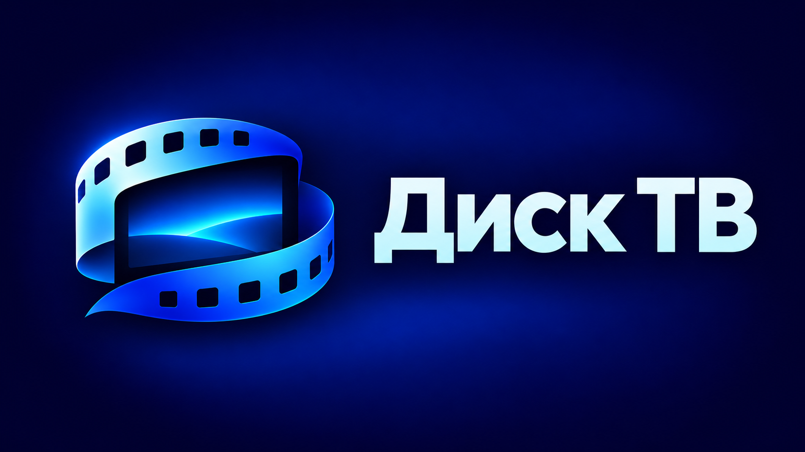

<p align="center">
  
</p>

# Диск ТВ

**Открыть диск → выбрать папку → смотреть.**

Небольшой DLNA-клиент для Android TV и Google TV. Находит медиасерверы в локальной
сети, показывает папки и видео, запоминает место остановки. Управляется обычным
пультом, без аккаунта и настройки медиатеки.

[](https://github.com/frtsvnth/disk-tv/actions/workflows/build.yml)
[](app/build.gradle)
[](LICENSE)

[Сайт проекта](https://frtsvnth.github.io/disk-tv/) ·
**[Скачать APK последней версии](https://github.com/frtsvnth/disk-tv/releases/latest/download/DiskTV-New.apk)** ·
[Все релизы](https://github.com/frtsvnth/disk-tv/releases) ·
[Сообщить о проблеме](https://github.com/frtsvnth/disk-tv/issues)

## Возможности

- Автоматическое обнаружение DLNA / UPnP MediaServer в сети Wi-Fi или Ethernet.
- Просмотр папок и файлов, включая большие папки с постраничной загрузкой.
- По умолчанию — алфавит и папки сначала. В настройках: название, размер, дата, длительность или порядок сервера, направление и группировка папок.
- Встроенный плеер на AndroidX Media3: пауза, точная перемотка и ускорение при удержании.
- Выбор аудиодорожек и встроенных субтитров с языками и названиями; выбор запоминается для файла.
- Внешние SRT, VTT, SSA/ASS и TTML, если сервер выдаёт ссылки или одноимённые файлы субтитров.
- Размер и оформление субтитров, предпочитаемые языки аудио и текста.
- Скорость 0.5–2×, масштаб изображения, информация о тегах, дорожках и кодеках.
- Выбор размера сетевого буфера и опциональная подстройка частоты экрана.
- Сохранение позиции встроенного плеера и предложение продолжить просмотр.
- Десять последних папок с сохранением после закрытия приложения.
- Выбор установленного внешнего плеера по долгому нажатию на видео.
- Плеер по умолчанию: встроенный или одно из подходящих приложений Android.
- Тёмный интерфейс с заметным фокусом пульта, форматом, размером и прогрессом файла.

## Установка

Нужен Android TV / Google TV с Android 8.0 (API 26) или новее. Один APK подходит
для 32- и 64-битных устройств. Телевизор и DLNA-сервер должны видеть друг друга
в локальной сети.

1. Скачайте `DiskTV-New.apk` из [Releases](https://github.com/frtsvnth/disk-tv/releases/latest).
2. Передайте APK на телевизор и откройте установщиком.
3. При необходимости разрешите установку из выбранного файлового менеджера.
4. Найдите «Диск ТВ» среди приложений и откройте свой сетевой диск.

При установке через ADB сначала подтвердите запрос отладки на телевизоре:

```sh
adb connect TV_ADDRESS:5555
adb -s TV_ADDRESS:5555 install -r DiskTV-New.apk
adb -s TV_ADDRESS:5555 shell am start -n io.frtsvnth.disktv/ru.tuvio.tools.dlnaclient.MainActivity
```

Для каждого релиза доступен `SHA256SUMS.txt` с контрольной суммой APK.

## Обновления на телевизоре

Начиная с 1.4.0 «Диск ТВ» при открытии проверяет последний стабильный выпуск
на GitHub. В настройках есть кнопка «Проверить обновления». Если версия новее,
приложение предложит скачать её и открыть системный установщик. Подтвердите
установку пультом. При первом таком обновлении Android может попросить разрешить
установку из «Диск ТВ». Обновление поверх старой версии сохраняет настройки и
историю. Кнопка «Позже» откладывает повторное предложение этой версии на сутки.

Пакет с версии 1.5.0 называется `io.frtsvnth.disktv`. Android устанавливает его
рядом со старым пакетом. Если приложение уже установлено, сначала обновите его
обычным способом, затем в настройках нажмите «Перейти на новый „Диск ТВ“».
После установки откройте новый «Диск ТВ». История, последние папки, настройки
сортировки и плееров переносятся локально при первом открытии. Старый пакет
показывается как «Диск ТВ (старая версия)». Его можно удалить после проверки переноса.

Для выпуска увеличьте `versionCode` и соберите оба варианта с прежним ключом.
Переименуйте `app-current-release.apk` в `DiskTV-New.apk`, а
`app-legacy-release.apk` в `DiskTV.apk`. В каталоге с готовыми файлами выполните:

```sh
python3 /path/to/disk-tv/tools/update_manifest.py DiskTV-New.apk --aapt "$ANDROID_HOME/build-tools/34.0.0/aapt" > update-new.json
python3 /path/to/disk-tv/tools/update_manifest.py DiskTV.apk --aapt "$ANDROID_HOME/build-tools/34.0.0/aapt" > update.json
shasum -a 256 DiskTV-New.apk DiskTV.apk > SHA256SUMS.txt
gh release create vX.Y.Z DiskTV-New.apk update-new.json DiskTV.apk update.json SHA256SUMS.txt --notes-file release-notes.md
```

Тег должен соответствовать `versionName` обоих APK. Публикуйте оба варианта в
одном стабильном релизе, чтобы владельцы прежнего пакета могли перейти без потери
истории. Перед запуском установщика приложение сверяет размер, SHA-256,
номер сборки, имя пакета и подпись.

## Управление и плееры

| Действие | Пульт |
| --- | --- |
| Выбрать диск, папку или видео | Стрелки |
| Открыть папку / запустить видео | ОК |
| Выбрать другой плеер для видео | Удерживать ОК |
| Вернуться назад | Назад |
| Изменить плеер, сортировку и параметры воспроизведения | «Настройки» на главном экране |
| Дорожки, субтитры, скорость и информация | Ряды «Звук», «Субтитры» и «Скорость» под шкалой, ОК — применить. «Ещё» или Menu — дополнительные параметры |
| Точная перемотка на шкале | Влево/вправо; удержание постепенно ускоряет шаг |

В меню выбора плеера отметьте **«Использовать по умолчанию»**, если хотите
сохранить выбор. Без отметки выбранное приложение используется только один раз.
Настройка применяется внутри «Диск ТВ» и не меняет системные предпочтения других
приложений Android.

В настройках можно в любой момент выбрать **«Встроенный плеер»** или другой
установленный плеер. Показываются приложения, которые Android предлагает для
открытия сетевого видео. Если выбранное приложение удалено или не подходит для
конкретного файла, «Диск ТВ» предложит выбрать другое.

Встроенный плеер и Vimu используют общую историю. При обычном выходе из Vimu
«Диск ТВ» сохраняет полученную позицию, если установленная версия Vimu её сообщает.
Завершённый фильм получает отметку «Просмотрено». Для любого плеера эту отметку
можно поставить или снять вручную, удерживая ОК на фильме. Остальные внешние
плееры ведут собственную историю.

## Встроенный плеер

Короткое нажатие на шкале перемещает позицию на одну секунду по умолчанию,
независимо от длины фильма. При удержании шаг увеличивается до 5 и затем 10 секунд.
Переход выполняется после завершения серии нажатий или подтверждения кнопкой ОК.
Базовый шаг можно изменить в настройках.

Аудио и субтитры выбираются в рядах под шкалой. По умолчанию
предпочитается русский звук. Форсированные субтитры, в том числе помеченные
`Forced` в названии, включаются автоматически. Если их несколько, приоритет у
языка выбранной аудиодорожки. Уже заданные языки и ручной выбор для фильма сохраняются. Показываются язык,
название и формат дорожки, если они есть в контейнере. Для возврата к предпочитаемому
языку выберите «По настройкам приложения». Субтитры можно полностью выключить.

Для внешнего файла субтитров подойдёт одноимённый файл, например `Film.mkv` и
`Film.ru.srt`, **если DLNA-сервер показывает этот файл или отдаёт ссылку на него**.
Приложение также распознаёт ссылки `CaptionInfo` / `CaptionInfoEx`. Если сервер
скрывает внешние субтитры, приложение не сможет получить их только по имени фильма.

«Информация и теги» показывает доступные метаданные Media3 и DLNA: название,
исполнителя, альбом, жанр, дату, длительность, видеоформат, разрешение, частоту кадров,
аудиодорожку и число дорожек субтитров. Набор тегов зависит от контейнера и сервера.

Подстройка частоты экрана изначально выключена. Она выбирает совместимый режим
в текущем разрешении и не изменяет глобальные настройки телевизора. Возможность
смены частоты зависит от прошивки. Настройка размера буфера ограничивает расход
памяти; для слабых устройств можно выбрать 16 МБ.

Поддержка звука, HDR, Dolby Vision и отдельных вариантов субтитров определяется
Media3 и декодерами устройства. Это не полный аналог движка Vimu: отдельного
FFmpeg-декодера, преобразования Dolby Vision и ручной синхронизации аудио/субтитров
в этой версии нет. Для файлов, требующих другого движка, доступен внешний плеер.

## Если диск не найден или видео не играет

- Убедитесь, что на роутере/NAS включён именно DLNA / UPnP MediaServer.
- Нажмите «Обновить» и проверьте, что устройства находятся в одной сети.
- Гостевая Wi-Fi-сеть, изоляция клиентов или VPN могут препятствовать обнаружению.
- Поддержка кодеков и звука зависит от телевизора и выбранного плеера.
- Перемотка зависит в том числе от возможностей медиасервера.

Приложение не реализует SMB, транскодирование, каталогизацию фильмов, постеры
из интернета или управление воспроизведением на другом DLNA-устройстве.

## Сборка из исходников

Требуются JDK 17 и Android SDK 34 с Build Tools 34.0.0. Gradle Wrapper включён
в репозиторий; отдельная установка Gradle не нужна.

```sh
git clone https://github.com/frtsvnth/disk-tv.git
cd disk-tv

# Укажите ANDROID_HOME либо sdk.dir в локальном local.properties.
./gradlew assembleCurrentDebug testCurrentDebugUnitTest lintCurrentDebug
```

Результат: `app/build/outputs/apk/current/debug/app-current-debug.apk`.
На Windows используйте `gradlew.bat`. В GitHub Actions выполняются те же сборка,
тесты и Android Lint; APK и отчёты сохраняются как артефакты запуска.

### Подписанная release-сборка

Закрытый ключ не входит в репозиторий. Для своей подписанной сборки задайте:

```sh
export DISKTV_KEYSTORE=/absolute/path/to/private-release.jks
export DISKTV_KEYSTORE_PASSWORD='your-store-password'
export DISKTV_KEY_ALIAS='your-key-alias'
export DISKTV_KEY_PASSWORD='your-key-password'
./gradlew assembleCurrentRelease assembleLegacyRelease
```

APK появятся в `app/build/outputs/apk/current/release/` и `app/build/outputs/apk/legacy/release/`. Без этих переменных release-сборка
будет неподписанной. Для обновления уже установленного APK нужен тот же ключ
подписи; debug- и собственные release-сборки могут использовать разные ключи.

### Локальные устройства

Пример профиля находится в [`devices.example.json`](devices.example.json).
Личные адреса можно сохранить в `devices.local.json`: этот файл игнорируется Git.
Приложению профиль не нужен — поиск DLNA выполняется автоматически.

## Проверки и устройство проекта

Автотесты покрывают разбор UPnP/DIDL XML, пространства имён, спецсимволы и ссылки,
SOAP-ошибки, загрузку всех страниц большой папки, повторяющиеся страницы,
прогресс просмотра, последние папки, выбранный плеер, сортировку,
метаданные и внешние субтитры, шаг перемотки и выбор частоты кадров.

Проверка на реальном телевизоре нужна для декодеров, системных плееров и поведения
конкретного пульта. Перед релизом полезно проверить: обычное и долгое ОК,
одноразовый выбор, выбор по умолчанию, возврат ко встроенному плееру, Back/Home,
закрытие приложения и повторный запуск.

Основной код находится в `app/src/main/java/ru/tuvio/tools/dlnaclient`:

- `Discovery`, `UpnpClient`, `UpnpXml` — поиск серверов и просмотр папок.
- `BrowserActivity`, `MainActivity` — навигация с пульта.
- `PlayerActivity`, `ResumeStore`, `RecentStore` — встроенное воспроизведение и история.
- `PlayerResolver`, `PlayerPicker`, `PlayerPreferences`, `SettingsActivity` — выбор плеера.
- `branding` — логотип и баннер приложения (PNG).

## Лицензия

[MIT](LICENSE).
Сведения о сторонних компонентах — в [THIRD_PARTY_NOTICES.md](THIRD_PARTY_NOTICES.md).

---

**English:** Disk TV is a minimal Android TV / Google TV DLNA browser with an
integrated Media3 player, resume positions, recent folders and external-player
selection by holding OK. Requires Android 8.0+. Download the signed APK from
[Releases](https://github.com/frtsvnth/disk-tv/releases/latest).
